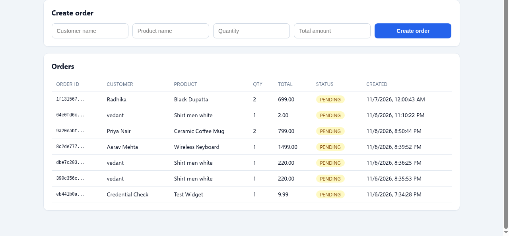
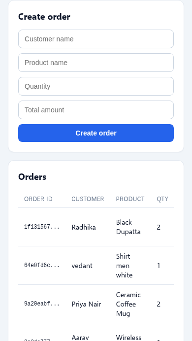
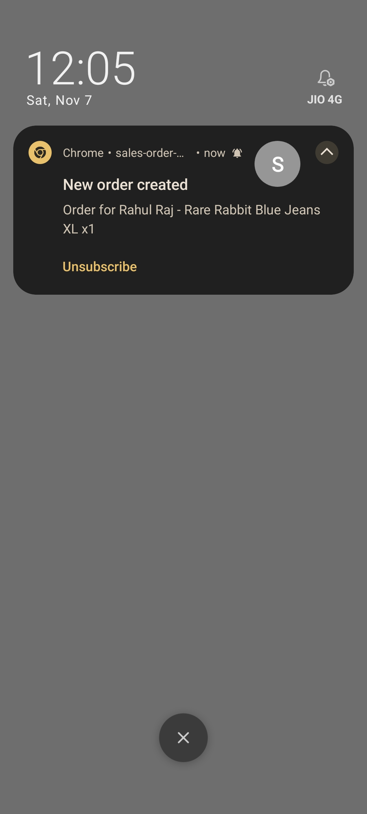

# Sales Order Management System with Real-Time Notifications

A full-stack sales order application: orders are created through a REST API, stored in
PostgreSQL, and every connected device gets a Firebase Cloud Messaging (FCM)
notification - a system notification on the phone/browser plus an automatic refresh of
the order list, with no manual page reload.

## Live Demo

- **Frontend (Vercel):** https://sales-order-management-wheat.vercel.app
- **Backend API (Render):** https://sales-order-api.onrender.com/api/orders

Free-tier notes (source: https://render.com/docs/free): the free PostgreSQL database
expires 30 days after creation (around Dec 6, 2026 for this deployment) followed by a
14-day grace period - take a backup or recreate before then. The free web service sleeps
after 15 minutes idle; the first request after sleep can take up to about a minute
(cold start). Subsequent requests are fast.

## Screenshots

**Desktop** - create orders from the form; the list below shows every order, newest
first, with ID, customer, product, quantity, total, status and creation time:



**Mobile** - the same UI adapts to small screens:



**FCM test** - a real push notification received on a phone (Chrome) when an order was created:



## How the App Works (end to end)

1. The React app loads and calls `GET /api/orders` to render the list.
2. The app asks the browser for notification permission, gets an FCM device token and
   registers it with `POST /api/devices/register`.
3. Anyone creates an order with `POST /api/orders` (Postman, curl, or the built-in form).
4. The backend validates the payload (class-validator DTOs), generates a UUID order ID
   and saves the order in PostgreSQL.
5. The backend sends an FCM notification ("New order created - Order for <customer> -
   <product> x<qty>") to every registered device token.
6. **App open (foreground):** the page's `onMessage` handler shows a system notification
   through the service worker, shows an in-app notice, and refetches the list - the new
   order appears by itself.
7. **App in background/closed:** the service worker
   (`frontend/public/firebase-messaging-sw.js`) displays the system notification;
   tapping it opens the app.

Stale device tokens reported by FCM are pruned automatically.

Try it: open the live app on your phone, allow notifications, then create an order from
a second device or Postman - the phone gets a system notification and the list updates
on its own.

## Tech Stack

| Layer    | Technology                                         |
| -------- | -------------------------------------------------- |
| Frontend | React 18 + Vite + TypeScript, Firebase JS SDK       |
| Backend  | Node.js + NestJS 10 + TypeORM                       |
| Database | PostgreSQL                                          |
| Push     | Firebase Cloud Messaging (Admin SDK on the server)  |

## Repository Layout

```
backend/    NestJS API (orders + device registration + FCM sender)
frontend/   React app (order form + live-updating list)
docs/       Screenshots used in this README
postman/    Postman collection for the API
render.yaml Render blueprint (backend + PostgreSQL deployment)
```

## API

Base URL: the deployed backend (`https://sales-order-api.onrender.com`) or
`http://localhost:3000` locally.

### POST /api/orders

Creates an order.

```json
{
  "customerName": "Aarav Mehta",
  "productName": "Red Roses Bouquet",
  "quantity": 2,
  "totalAmount": 1499.00
}
```

Validation: all four fields required, `quantity` integer >= 1, `totalAmount` number >= 0
(max 2 decimals). Optional `status`: `PENDING` (default) | `CONFIRMED` | `SHIPPED` |
`DELIVERED` | `CANCELLED`. Invalid payloads return `400` with per-field error messages.
Returns the saved order including its generated `id` and `createdAt`.

### GET /api/orders

Returns all orders as JSON, sorted by `createdAt` descending (newest first).

### POST /api/devices/register

```json
{ "token": "<firebase-device-token>" }
```

Stores (or refreshes) an FCM device token so the backend can push notifications to it.

## Getting Started

Prerequisites: Node.js 20+, a PostgreSQL database, and a Firebase project (free Spark
plan is enough).

### Backend

```bash
cd backend
cp .env.example .env       # fill in values (see below)
npm install
npm run start:dev          # http://localhost:3000
```

### Frontend

```bash
cd frontend
cp .env.example .env       # fill in values (see below)
npm install
npm run dev                # http://localhost:5173
```

Open the app, allow notifications, then create an order from a second device or Postman
and watch the list update by itself.

## Environment Variables

### Backend (`backend/.env`)

| Variable                | Description                                                        |
| ----------------------- | ------------------------------------------------------------------ |
| `PORT`                  | HTTP port (default 3000)                                            |
| `FRONTEND_ORIGIN`       | Comma-separated allowed CORS origins (`*` for local dev)            |
| `FRONTEND_URL`          | Optional frontend URL attached to push notifications                |
| `DATABASE_URL`          | PostgreSQL connection string                                        |
| `DATABASE_SSL`          | `true` when the database requires SSL (hosted Postgres)             |
| `FIREBASE_PROJECT_ID`   | Firebase project ID                                                 |
| `FIREBASE_CLIENT_EMAIL` | Service account client email                                        |
| `FIREBASE_PRIVATE_KEY`  | Service account private key, single line with `\n` escapes          |

If the Firebase variables are missing, the API still works; notifications are skipped
with a warning in the logs.

### Frontend (`frontend/.env`)

| Variable                            | Description                                   |
| ----------------------------------- | --------------------------------------------- |
| `VITE_API_URL`                      | Backend base URL (empty = Vite dev proxy)      |
| `VITE_FIREBASE_API_KEY`             | Firebase web app config (Project settings)     |
| `VITE_FIREBASE_AUTH_DOMAIN`         | ...                                            |
| `VITE_FIREBASE_PROJECT_ID`          | ...                                            |
| `VITE_FIREBASE_STORAGE_BUCKET`      | ...                                            |
| `VITE_FIREBASE_MESSAGING_SENDER_ID` | ...                                            |
| `VITE_FIREBASE_APP_ID`              | ...                                            |
| `VITE_FIREBASE_VAPID_KEY`           | Web Push certificate key (Cloud Messaging tab) |

## Firebase Setup

1. Create a project at <https://console.firebase.google.com>.
2. Project settings -> Your apps -> add a **Web app**; copy the config values into
   `frontend/.env`.
3. Project settings -> Cloud Messaging -> Web configuration -> **Generate key pair**;
   copy it to `VITE_FIREBASE_VAPID_KEY`.
4. Project settings -> Service accounts -> **Generate new private key**; use its
   `project_id`, `client_email` and `private_key` for the backend env vars.
   Never commit this JSON file.

## Database

Any PostgreSQL database works. TypeORM `synchronize` creates the tables on first boot -
no manual migration needed. Local quick start with Docker:

```bash
docker run --name sales-orders-db -e POSTGRES_PASSWORD=postgres \
  -e POSTGRES_DB=sales_orders -p 5432:5432 -d postgres:16
```

## Deployment

### Backend + database (Render, free tier)

`render.yaml` is a Render Blueprint: dashboard -> **New -> Blueprint** -> pick this repo.
It creates the `sales-order-api` web service and a free `sales-orders-db` PostgreSQL
instance and wires `DATABASE_URL` automatically. Fill the `sync:false` variables
(Firebase service account, `FRONTEND_ORIGIN`) when prompted.

### Frontend (Vercel, free tier)

Import the repo in Vercel with **Root Directory = `frontend`** (Vite is auto-detected)
and add the `VITE_*` environment variables from `frontend/.env`. Then set
`FRONTEND_ORIGIN`/`FRONTEND_URL` on the backend to the Vercel URL and redeploy it.

## Postman Collection

Import `postman/FNP-Sales-Orders.postman_collection.json`, set the `baseUrl` variable to
the backend URL, and run **Create Order** - every connected browser tab updates live.
